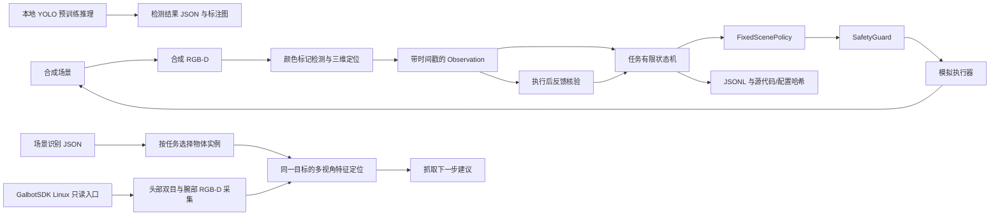

# 离线架构 V0.1

已实现路径使用高层任务动作，不包含任何假设的 G1 关节角、自由度、末端型号或运动速度。实际机器人运动适配需独立实现，不能将模拟动作目标直接转换为底层控制命令。

识别、执行反馈和任务决策交换的字段见 [识别与决策接口 V1](vision-decision-interface.md)。

## 观测和证据

每次状态进入和每次执行后都重新生成图像并运行检测。固定颜色仅识别约定标记，不能识别真实餐具语义。标记质心结合已对齐米制深度、相机内参和刚体外参，变换到 `base_link`。拒绝无效深度、多处同色标记、非刚体外参、过期观测和过大时间差。

抓持状态、取食状态和倒入结果来自明确标注的模拟器状态。当前没有从真实图像判断勺内食物或抓取成功的算法；这也是接入实机时必须补上的反馈模块。

`TaskRunner` 只接受 `simulation_only` 后端和合成观测来源。所有结果均标明实机验收未测试、ACT 未训练、食品量未测量。自动化测试的通过不能提升这些状态。

## 任务状态机

`observe → locate_spoon → grasp_spoon → acquire_food → pour_food → return_spoon → grasp_bowl → place_bowl → verify → complete`

检测、执行、反馈或停止失败时进入 `failed`，锁存停止原因，不自动重试。动作不成功时不会继续下一步；机器人断联/高速控制等问题当前无法在该模拟器中验证。

确定性策略根据最新观测选取目标，不是完整预录动作回放。勺子归位使用首帧观测到的归位位置。放置结果和最终结果分别检查，能检测放置后目标再次被移动的情况。

## 后续策略接入

LeRobot 只作为独立学习工具链。ACT 候选需具备本机示范数据、相机与动作字段映射、归一化统计、采集频率、完整 Episode 评估和本地 checkpoint。禁止默认复用 Unitree G1 配置。

官方下载的转换器采用 23 维数据样例及 `action[t] = state[t+1]`，这属于该工具的数据约定，不能当作现场 G1 的通用硬件规格或控制语义。训练前逐项确认。LeRobot 软件版本与 Dataset 格式版本分别锁定；若升级新版框架，先迁移和核验数据格式。

ACT 不作为固定场景基线的强制依赖。先根据基线失败记录判断是否需要训练局部舀取或倒入策略。无真实数据时不生成冒充可用技能的训练模型。

## 尚未实现的实机约束

碰撞几何、附着工具/餐碗、关节限位、速度/加速度约束、控制器权限、夹爪力、接触控制、命令超时与通信失效均需现场验证。本项目的高层工作区检查不等同于完整机器人安全控制。
