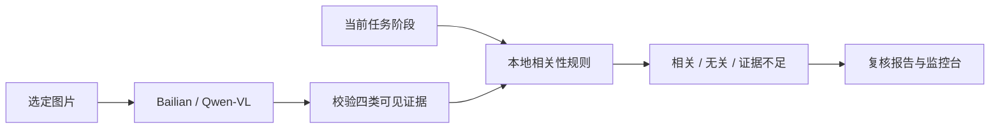

# 百炼视觉与任务相关性

百炼适配器接收一张明确选择的图片，调用通义千问视觉模型并返回四类物体的可见证据。项目使用百炼 OpenAI 兼容接口，默认模型为 `qwen3-vl-plus`，以 JSON Object 模式请求。输出经过本地字段校验，然后交给阶段相关性规则。[百炼视觉接口](https://help.aliyun.com/zh/model-studio/qwen-vl-compatible-with-openai) · [结构化输出](https://www.alibabacloud.com/help/en/model-studio/qwen-structured-output)



例如同一张图中出现勺和餐碗，抓勺阶段只把勺列为相关候选。切换到抓碗阶段后，餐碗成为相关候选。目标看不见、难以区分、响应不完整或服务异常时，结果为暂停。相关候选进入本地复核，坐标和动作继续由原有定位、控制检查与反馈链路负责。

先运行离线规则测试。报告写入 `artifacts/relevance/fixtures.json`，覆盖同图切换阶段、目标缺失、遮挡歧义、餐碗与食品容器区分等六个场景。

```powershell
.\.venv\Scripts\python.exe -m pet_meal relevance-test
```

如已在当前 PowerShell 配置 `DASHSCOPE_API_KEY`，运行以下命令。默认用一张公开照片做一次百炼请求，再用同一份观测分别评估抓勺、抓碗和获取食品三个阶段。

```powershell
.\.venv\Scripts\python.exe -m pet_meal bailian-vision --live --image models/tableware-cc0.jpg
```

也可加 `--prompt-key`，在本机交互终端隐式输入密钥。默认接入地址是北京的兼容接口。请用 `DASHSCOPE_BASE_URL` 或 `--base-url` 指定密钥所在地域的官方地址，地址以 `/compatible-mode/v1` 结尾。可通过 `--phase` 多次指定阶段。监控台“测试报告”读取 `artifacts/relevance/bailian.json`，分别显示离线预设证据和云端结果。

真实调用将选定图片缩小到长边最多 1280 像素，重新编码为 JPEG 后发送到百炼。报告保存图片哈希、模型、请求 ID、耗时和结构化证据。认证只在进程内使用。云端错误、未配置密钥和成功返回分别通过报告状态区分。
