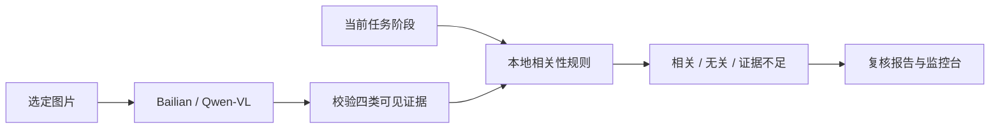

# 百炼视觉与任务相关性

百炼适配器接收一张明确选择的图片，调用通义千问视觉模型并返回四类物体的可见证据。项目使用百炼 OpenAI 兼容接口，默认模型为 `qwen3-vl-plus`，以 JSON Object 模式请求。输出经过本地字段校验，然后交给阶段相关性规则。[百炼视觉接口](https://help.aliyun.com/zh/model-studio/qwen-vl-compatible-with-openai) · [结构化输出](https://www.alibabacloud.com/help/en/model-studio/qwen-structured-output)

可见性报告与执行观测之间的边界见 [识别与决策接口 V1](vision-decision-interface.md)。



例如同一张图中出现勺和餐碗，抓勺阶段只把勺列为相关候选。切换到抓碗阶段后，餐碗成为相关候选。目标看不见、难以区分、响应不完整或服务异常时，结果为暂停。相关候选进入本地复核，坐标和动作继续由原有定位、控制检查与反馈链路负责。

先运行离线规则测试。报告写入 `artifacts/relevance/fixtures.json`，覆盖同图切换阶段、目标缺失、遮挡歧义、餐碗与食品容器区分等六个场景。

```powershell
.\.venv\Scripts\python.exe -m pet_meal relevance-test
```

如已在当前 PowerShell 配置 `DASHSCOPE_API_KEY`，运行以下命令。默认用一张公开照片做一次百炼请求，再用同一份观测分别评估抓勺、抓碗和获取食品三个阶段。

```powershell
.\.venv\Scripts\python.exe -m pet_meal bailian-vision --live --image models/tableware-cc0.jpg
```

也可加 `--prompt-key`，在本机交互终端隐式输入密钥。默认接入地址是北京的兼容接口。请用 `DASHSCOPE_BASE_URL` 或 `--base-url` 指定密钥所在地域的官方地址，地址以 `/compatible-mode/v1` 结尾。可通过 `--phase` 多次指定阶段。监控台“测试报告”读取 `artifacts/relevance/bailian.json`，分别显示离线预设证据和云端结果。

真实调用将选定图片缩小到长边最多 1280 像素，重新编码为 JPEG 后发送到百炼。报告保存图片哈希、模型、请求 ID、耗时和结构化证据。认证只在进程内使用。云端错误、未配置密钥和成功返回分别通过报告状态区分。

## 从现有场景里选择抓取动作

`scene-action` 可把明确选定的一张图片、抓取意图和按本地 ID 或类别筛选的候选物体发给百炼。模型只能从候选中选择 `grasp`，或返回 `reobserve_target`、`disambiguate_target`。项目在本地校验字段和值，再交由原有的多相机定位与夹爪反馈逻辑决定下一步。结果保存在同一份报告的 `bailian` 和 `next_action` 字段。

```powershell
.\.venv\Scripts\python.exe -m pet_meal scene-action --observation observation_all.json --category bottle --bailian-image wrist-crop.jpg --intent "抓取蓝盖透明水瓶" --output artifacts/relevance/grasp-choice.json
```

将百炼通用 API Key 配置为 `DASHSCOPE_API_KEY`。可用 `DASHSCOPE_BASE_URL` 和 `DASHSCOPE_MODEL` 覆盖默认配置。配有同一物体多视角像素和采集时戳时，可附加 `--capture`，让本地定位流程复核。遇到无效响应或服务错误时暂停。报告的 `dispatch_allowed` 保持为 `false`。

## Token Plan 交互式选择

包含 `token-plan.cn-beijing.sh` 的配置笔记用于接入交互式工具。阿里云为套餐提供了专用端点，并将套餐密钥限定在兼容工具中交互式使用。项目可用 `--bailian-config bailian.txt` 读取文件里的 `sk：` 项，直连时需要通用 API Key。安装命令作为笔记内容保留。[Token Plan 使用范围](https://help.aliyun.com/zh/model-studio/token-plan-overview) · [交互式视觉接入](https://help.aliyun.com/zh/model-studio/add-vision-skill)

在已配置 Token Plan 的工具中选择支持图像的模型，例如 `qwen3.7-plus`，附上同一场景的裁图和候选 ID。请模型只输出包含 `action` 和 `object_id` 的 JSON。找到唯一目标时使用 `grasp`，其余情况使用 `reobserve_target` 或 `disambiguate_target` 并将 ID 设为 `null`。把 JSON 保存为 `vision-choice.json`，交回本地决策。

```powershell
.\.venv\Scripts\python.exe -m pet_meal scene-action --observation observation_all.json --category bottle --vision-choice vision-choice.json --capture <采集目录>
```

导入报告记录为 `imported_vision`。本地会校验候选 ID、定位证据与夹爪反馈，结果用于规划前复核。

## 本地 Qwen3-VL 回放

将官方 Qwen3-VL-2B-Instruct 的模型文件放在 `models/qwen3-vl-2b-instruct`，使用安装了 PyTorch、Pillow 和 Transformers 4.57 的本地环境。也可用 `--local-model` 指定其他 Qwen3-VL 本地 checkpoint 目录。

```powershell
.\.venv\Scripts\python.exe -m pet_meal scene-action --observation observation_all.json --category bottle --local-image wrist-crop.jpg --intent "抓取蓝盖透明水瓶"
```

本地模型和百炼使用相同的候选 ID 与动作校验。图像在本机推理，报告将模型选择记在 `local_vlm`。定位和夹爪反馈仍由同一份本地决策检查。
