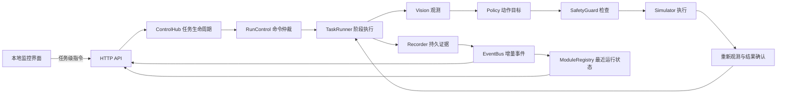

# V0.2 控制中枢设计

中枢运行在本机回环地址。浏览器负责发出任务级指令和读取监控信息，所有动作由 Python 任务进程执行。既有 `simulate` 命令仍可独立运行，界面和命令行复用同一套任务链路。

- `hub.py` 管理任务、运行目录、最新状态和停止锁存。并发启动只允许一个请求进入。
- `control.py` 在阶段边界串行处理运行、暂停和停止。继续时从新观测开始。模拟器的一个阶段包含观测、检查、执行和确认，暂停或软件停止在阶段边界生效。
- `decision.py` 定义任务步骤。`vision.py`、`policy.py`、`safety.py` 分别提供定位、动作选择和动作前检查。`simulator.py` 返回执行结果。结果确认独立于执行回执。
- `recording.py` 将任务事件、源码与配置哈希写入 JSONL。`events.py` 保留有界增量流，`modules.py` 根据实际事件显示模块最近结果。操作按钮事件进入实时流，任务事件和停止结果保留在运行文件中。
- `server.py` 只接受本机任务级请求。`ui/` 读取状态、事件、原始帧、运行历史和测试报告。实机 SDK 仍处在独立的只读采集边界。

任务启动后进入运行态。暂停保留当前进度。软件停止结束任务并锁存。故障也会锁存并记录首次失败的模块和阶段。只有任务结束后才能复位。复位解除锁存并保留上一条结果供查看。

“已执行”计数表示模拟执行接口返回，“已确认”计数表示后置条件通过。抓取未确认场景的两项计数分别为 1 和 0。控制台展示已确认动作，历史记录可读取早期只有执行计数的日志。

## 测试证据

`scripts/validate.py` 执行正常场景和七类故障，随后运行自动化用例。浏览器可以单独重跑每种场景并检查状态、画面和日志。

真实照片视觉测试使用 SomeBodyAnyBody05 发布的碗与勺照片，CC0 1.0。源文件 SHA-1 为 `dad5b66aed30242e3222471efb08aa6a078cdef5`。模型在本机 GPU 返回碗 0.695、勺 0.668，同时在勺的近似相同区域给出刀 0.397。以上数值是单图预测置信度。完整结果见 `artifacts/vision-tableware/predictions.json`。 [原图和许可证](https://commons.wikimedia.org/wiki/File:Fiber_One_in_a_bowl_with_milk_and_a_spoon.jpg)

完整流程使用合成 RGB-D 和模拟状态反馈。机械臂运动、接触、抓取稳定性、粮食流动和定量能力仍待实机或动力学模型验证。软件停止只作用于当前模拟任务。后续实机控制需要独立验证停止通道、命令超时、限位和碰撞约束。
