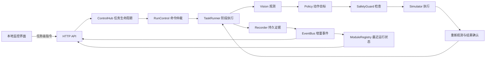

# 控制中枢设计

中枢运行在本机回环地址。浏览器负责发出任务级指令和读取监控信息，所有动作由 Python 任务进程执行。既有 `simulate` 命令仍可独立运行，界面和命令行复用同一套任务链路。



- `hub.py` 管理任务、运行目录、最新状态和停止锁存。并发启动只允许一个请求进入。
- `control.py` 在阶段边界串行处理运行、暂停和停止。继续时从新观测开始。模拟器的一个阶段包含观测、检查、执行和确认，暂停或软件停止在阶段边界生效。
- `decision.py` 定义任务步骤。`vision.py`、`policy.py`、`safety.py` 分别提供定位、动作选择和动作前检查。`simulator.py` 返回执行结果。结果确认独立于执行回执。
- `recording.py` 将任务事件、源码与配置哈希写入 JSONL。`events.py` 保留有界增量流，`modules.py` 根据实际事件显示模块最近结果。操作按钮事件进入实时流，任务事件和停止结果保留在运行文件中。
- `server.py` 只接受本机任务级请求。`ui/` 读取状态、事件、原始帧、运行历史和测试报告。G1 桌面任务和模拟任务共享中枢与运行记录。

任务启动后进入运行态。暂停保留当前进度。软件停止结束任务并锁存。故障也会锁存并记录首次失败的模块和阶段。只有任务结束后才能复位。复位解除锁存并保留上一条结果供查看。

“已执行”计数表示模拟执行接口返回，“已确认”计数表示后置条件通过。抓取未确认场景的两项计数分别为 1 和 0。控制台展示已确认动作，历史记录可读取早期只有执行计数的日志。

## G1 桌面任务规划

监控页的「G1 桌面任务规划」调用本机 `POST /api/tabletop/plan`，使用现有控制令牌。`capture`、`observation` 和可选 `vision_choice` 使用相对于 `artifacts` 的路径。任务字段为 `skill`、二选一的 `object_id` 或 `category`，以及可选的 `repeat_count`。控制台和 CLI 使用同一个 `ControlHub.start_tabletop` 入口，和模拟任务共享单任务仲裁、停止锁存和事件记录。

提交规划或模拟时，`202` 回执会立即带上 `run_id`。调用方用 `GET /api/runs/{run_id}` 查询本次任务的 `status`、`active` 和 `summary`，可通过 `GET /api/events?after=<cursor>` 读取同一 `run_id` 的事件。请求可附加 `request_id`，由调用方为一次业务请求生成，例如 UUID。中枢持久化请求指纹，同一个 `request_id` 重试同一请求时返回原 `run_id` 和 `replayed: true`。用同一 ID 提交不同任务、路径或模式会返回 `409`。服务重启后，若有受理记录但缺最终结果，按 ID 查询会返回 `unconfirmed`。这类任务需要核对原回执。

`object_id` 指瓶子实例。`scene_revision` 将场景证据绑定到候选。`candidate_id` 和 `stage_id` 分别指一次任务内的姿态候选和执行阶段。HPU 分段执行器为实机指令创建 `command_id`，实机任务通过独立的 `/api/tabletop/execute` 受理。设备、探针、回执和现场条件见 [实机接入说明](hardware-handoff.md)。

```powershell
$capture = 'artifacts/g1-grasp-geometry-20261107T180009.730799Z'
python -m pet_meal g1-task-plan --capture $capture `
  --observation "$capture/bailian-scene-selection/observation-replay.json" `
  --vision-choice "$capture/bailian-scene-selection/choice-import-fixture.json" `
  --category bottle --skill shake_then_place
```

1. `TaskRequest` 选择抓取、取放或摇后放回。导入视觉选择时，所选 ID 必须来自本次任务候选。中枢复用 `recommend_scene_grasp` 检查同步定位与夹持状态。上面的原始记录应返回 `held / gripper_unknown`。
2. `SceneSnapshot` 将已定位实例、相机时戳、关节和夹爪测量与碰撞模型绑定。采集目录须有 `geometry.json`，提供 `cap.head_stereo.point_m`、`cylinder` 的 `center_m`、`radius_m`、`height_m` 和 `grip_height_m`，以及 `obstacles` 的 `table_box`、`point_cloud` 和 `voxel_m`。点云为采集目录内的 PCD。当前使用外部测量结果，采集命令本身尚未自动拟合瓶体或分割障碍。桌面、瓶体和点云都在 `base_link`，各相机原始证据仍使用原有采集格式。
3. `StagePlan` 为左侧两指夹爪生成六组瓶身侧抓候选，覆盖水平和俯角进给。阶段声明各自的 TCP 路点、是否带载和预期验收证据。`geometry.json` 可用 `tool_model: "galbot_ge102in"` 指定 E102，其 TCP 为 `left_ge102_contact_link`。旧记录默认使用 `galbot_gripper`。放置回到原瓶位。`preview` 表示生成候选，`planning_results` 为空表示未调用 SDK。回放的 `motion_commands_sent` 恒为 0。
4. HPU 上可在已配置 Galbot SDK 1.10 和左夹爪模型的环境中使用 `--planner sdk`。生成 `geometry.json` 时须同时写入同批 `capture.json` 文件的 SHA-256，即 `capture_sha256` 字段。适配器用采集关节为起点，向规划器加载测量桌面、点云和瓶体，开启环境碰撞检查和自碰撞相关的规划检查，并复核终点 FK。只运行预抓和直线进给。闭夹、带载、摇动和放回的 SDK 校验仍待接入夹持和带载模型。浏览器入口只做本地预览。软件停止在规划调用之间生效。

每次运行的 `events.jsonl` 和 `summary.json` 写入 `artifacts/hub-runs`。`task_candidate` 记录候选和场景版本，`task_stage_reviewed` 记录 SDK 规划结果、计划终点的 TCP 位姿和相对目标的误差。真机夹持、离桌和释放确认均需后续实测。

### 通过 HTTP 运行水瓶模拟

先用 `python -m pet_meal monitor --port 8765` 启动本地服务。`POST /api/tabletop/simulate` 接受与规划预览相同的场景和任务，增加可选 `fault`。它复用现有识别、视觉选择和候选规划，使用理想 TCP 跟踪和刚性附着生成逐段模拟反馈。`motion_commands_sent` 始终为 0，真实关节逆解、碰撞、接触力和滑移均需在实机侧另行验证。

```powershell
$base = 'http://127.0.0.1:8765'
$headers = @{ 'X-Control-Token' = (Invoke-RestMethod "$base/api/status").control_token }
$parsed = Invoke-RestMethod "$base/api/tabletop/interpret" -Method Post -Headers $headers `
  -ContentType 'application/json; charset=utf-8' `
  -Body (@{ text = '抓起水瓶，摇一下再放回。' } | ConvertTo-Json)
$capture = 'g1-grasp-geometry-20261107T180009.730799Z'
$payload = @{
  request_id = [Guid]::NewGuid().ToString()
  task = $parsed.task
  capture = $capture
  observation = 'g1-task-offline-test/observation-simulated-empty-gripper.json'
  vision_choice = "$capture/bailian-scene-selection/choice-import-fixture.json"
  fault = 'none'
}
$receipt = Invoke-RestMethod "$base/api/tabletop/simulate" -Method Post -Headers $headers `
  -ContentType 'application/json; charset=utf-8' -Body ($payload | ConvertTo-Json -Depth 5)
do {
  Start-Sleep -Milliseconds 100
  $status = Invoke-RestMethod "$base/api/runs/$($receipt.run_id)"
} while ($status.active)
$status.summary.simulated_stage_results | Format-Table stage_id, status, bottle_lift_m, shake_cycles
```

正常用例依次核对预抓、进给、闭夹、试提、抬升、摇动、下降、释放和退出。把 `fault` 改为 `grasp_unconfirmed` 可复测夹持失败，预期返回 `held`，最后一段为 `close`，摇动次数为 0。运行摘要可从 `GET /api/summary` 读取，逐段记录也进入 `GET /api/events?after=0` 和本地日志。把 `observation` 换回原始采集的 `observation-replay.json` 时，夹持状态保持未知，任务停在场景核对阶段。

### 本地中文任务入口

从控制台打开「语音与直控」，或访问 `/operator`。支持 Document Picture-in-Picture 的浏览器可将此页置顶。操作员点击「开始听写」后，浏览器使用电脑麦克风转写普通话，识别服务由浏览器提供。也可以直接编辑文本。点击「解析到任务」将最终文本交给本机中枢，核对动作和目标后，再点击「确认并生成规划」。

前端先从 `GET /api/status` 读取本机控制令牌，再用 `X-Control-Token` 调用 `POST /api/tabletop/interpret`。JSON 请求只含 `text`，成功返回 `task` 和 `dispatch_allowed: false`，无法确认的短句返回 409。此入口只解析明确的瓶子指令，取后放回映射为 `pick_place`，只有明确说出摇动及次数才映射为 `shake_then_place`。规划仍由 `POST /api/tabletop/plan` 提交，状态和回执由 `GET /api/status` 与 `GET /api/summary` 读取。可用 `capture`、`observation`、`vision_choice` 查询参数预填相对于 `artifacts` 的路径。

可选依赖为 `.[nlp]`，并需有已缓存的中文 BERT 或本地模型目录。训练入口 `g1-task-nlp-fit --train <JSONL> --validation <JSONL> --output <checkpoint.pt>` 在同一 BERT 编码器上训练意图分类和 BIO 槽位标注两个头。每行包含 `group`、`text`、`intent` 和 `slots`。槽位记录 `label`、`start`、`end`，偏移按 Python 字符下标计算，`end` 为排他边界。训练和验证应按同义句组分离。意图为 `grasp`、`pick_place`、`shake_then_place`、`serve_recipe` 和 `hold`。可标注物体类别 `category`、实例描述 `attribute`、目的地 `destination`、次数 `repeat_count` 和菜谱 `recipe`。

`g1-task-plan --text <中文任务> --nlp-model <checkpoint.pt>` 把中文解析为同一个 `TaskRequest`。低置信度、含糊目标和无法映射的槽位暂停任务。菜谱名称和 ID 从 `working/frontend` 核对，当前 G1 只接通瓶子技能。训练入口报告验证集意图准确率、宏 F1 和整句槽位完全匹配率。使用现场标注语料完成评估前，模型结果仅用于软件验证。

### 10 秒音乐与动作演出

「语音与直控」的舞蹈预演可载入本地音频，从指定秒数截取 10 秒，使用同一音频时钟显示进度和头部摆动，也可导出 16 kHz 单声道 PCM WAV。页面从 `GET /api/show` 读取动作时间线。动作参考银河通用 Apache-2.0 示例中的左右摆头，缩小到当前头部偏航的 ±0.10 rad，并以余弦插值回到起始角。 [GalbotSDK 原始示例](https://github.com/GalaxyGeneralRobotics/GalbotSDK/blob/main/examples/g1/python/galbot_robot/installation_welcome_verify.py)

现场 Linux HPU 使用 `python3 -m pet_meal.g1_show --wav <导出的 WAV> --audio-only` 验证扬声器。联演前，先运行 `python3 -m pet_meal.g1_show --scene-obstacle <已核对的现场障碍物 ID>` 检查当前定位、静止姿态和全程碰撞采样。现场人员确认清场并可操作急停后，联演命令再附加 `--wav <导出的 WAV> --execute`。实机测试将 PCM 振幅设为原始的四分之一，沿用机器人当前音量。浮窗的停止按钮作用于本地预演。

## 测试证据

`scripts/validate.py` 执行正常场景和七类故障，随后运行自动化用例。浏览器可以单独重跑每种场景并检查状态、画面和日志。

真实照片视觉测试使用 SomeBodyAnyBody05 发布的碗与勺照片，CC0 1.0。源文件 SHA-1 为 `dad5b66aed30242e3222471efb08aa6a078cdef5`。模型在本机 GPU 返回碗 0.695、勺 0.668，同时在勺的近似相同区域给出刀 0.397。以上数值是单图预测置信度。完整结果见 `artifacts/vision-tableware/predictions.json`。 [原图和许可证](https://commons.wikimedia.org/wiki/File:Fiber_One_in_a_bowl_with_milk_and_a_spoon.jpg)

宠物餐仿真流程使用合成 RGB-D 和模拟状态反馈。接触、抓取稳定性、粮食流动和定量能力仍待实机或动力学模型验证。后续实机控制需要独立验证停止通道、命令超时、限位和碰撞约束。
