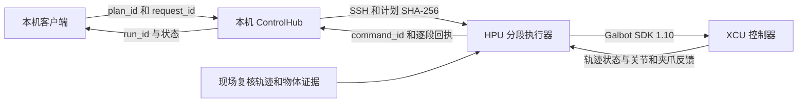

# 银河 G1 实机接入

本机中枢在 Windows 上受理任务、回放场景和记录结果。Linux HPU `galbot-echo` 运行银河 SDK 和规划服务。XCU `galbot-xcu` 管理整机模式与底层控制。已核实的登录路径为 PC → `galbot@192.168.166.102` → `root@192.168.1.66`。现场地址以本机配置为准，SSH 凭据留在本地。

XCU 使用以下命令启动官方模式工具。等待菜单和通信就绪后，`q` 查看整机序列号和模式，`v` 查看软件基线。`[folder_mkdirs]` 表示日志目录存在。抓取规划还需确认整机为 `WORKING_MODE` 且 HPU 的 `service_motion_plan` 已就绪。

```bash
cd /data/bin
LD_LIBRARY_PATH=/data/lib ./sys_tool
```

## 已核对的设备标识

- 设备为 Galbot G1，XCU 的 `sys_tool q` 已确认序列号为 `R001ABDD22AA0250`。HPU 已核对 SDK `1.10.0`。接入新设备时从 `sys_tool` 重新核对序列号和基线版本。
- 左右夹爪均记录为 E102，SDK `type_code=98`。当前抓瓶计划使用 `left_arm` 和 `left_gripper`。规划工具模型是 `galbot_ge102in`，接触坐标为 `left_ge102_contact_link`，法兰为 `left_arm_end_effector_mount_link`。
- E102 左右指尖碰撞链接分别为 `left_ge102_left_active_link2` 和 `left_ge102_right_active_link2`。工具接触坐标相对法兰的平移经实测关节 FK 验证，约为 `[0.17343, 0, 0.0003655] m`。查错时要区分规划工具名、夹爪控制组名和 TCP 坐标名。
- 当前桌面规划坐标是 `base_link`。TCP 位姿使用 `[x, y, z, qx, qy, qz, qw]`，位置单位为米，关节单位为弧度。`timestamp_ns` 使用纳秒整数，Go 用 `int64` 或 `json.Number`。现有适配器采用固定基座参考。接入地图障碍时要验证 `map` 到 `base_link` 的变换。

## 控制接口和责任边界



- **本机中枢**通过 `POST /api/hardware/probe` 读取 HPU 和 XCU，使用 `POST /api/tabletop/execute` 受理经 HPU 复核的计划。回执为 `202` 和 `run_id`，随后用 `GET /api/runs/{run_id}` 查结果。`request_id` 用于幂等重试。规划预览与模拟分别走 `/api/tabletop/plan` 和 `/api/tabletop/simulate`。
- **HPU 采集**用 `GalbotRobot` 读取头部双目、腕部 RGB-D、关节和夹爪状态。项目的实采入口为 `scripts/g1_capture_multiview.py`。相机需校验匹配帧、内外参和深度单位。最新实拍仍需补瓶体几何与空夹持证据。
- **HPU 规划**用 `GalbotMotion.motion_plan` 生成预抓轨迹，`move_line` 做直线进给，`forward_kinematics_by_state` 核验计划终点。`is_direct_execute=False`，并开启环境碰撞检查。当前规划校验到预抓与进给，闭夹与带载阶段仍需接入。
- **HPU 分段执行器**调用 `GalbotRobot.execute_joint_trajectory` 或 `set_gripper_command`，分别记录 SDK 接收、XCU 轨迹状态、实际关节或开度，以及物体验收。每段先核对 XCU 模式和现场证据，再绑定新的 `command_id`。试提确认瓶体离桌后才进入摇动。
- **停止与时序**。中枢停止会向 HPU 发送取消，HPU 检查心跳并在关节轨迹执行中调用 `stop_trajectory_execution`。夹爪中断单独记录为待核对。SDK 1.10.0 的标准关节轨迹用点位和时间序列，速度、加速度与力矩字段不用于限速验收。回执丢失时，核对 HPU 上的日志和现场状态再继续。 [银河 SDK 控制参考](https://developer.galbot.com/docs/SDK/1.10.0/g1/en/api_python_reference/) · [银河模式工具说明](https://developer.galbot.com/docs/SDK/1.10.0/g1/en/troubleshooting/#how-to-check-the-current-operating-mode)

本机与 HPU 各自保存逐段回执。记录用 `robot_sn`、`run_id`、`scene_revision`、`candidate_id`、`stage_id`、`tool_model` 和 `command_id` 关联。`command_id` 由本项目分配，XCU 回读来自 SDK 对左臂轨迹状态和实测关节的查询。

## 本机实机接口

当前联调实例在 [本机 HPU 中枢](http://127.0.0.1:8767)。左侧的「检查 HPU 与 XCU」触发一次只读探针。探针比对 XCU `sys_tool` 和 SDK 的整机序列号，读取左臂轨迹状态、关节位置及左夹爪开度。可在 PowerShell 中单独查询。

```powershell
$base = 'http://127.0.0.1:8767'
$token = (Invoke-RestMethod "$base/api/status").control_token
Invoke-RestMethod "$base/api/hardware/probe" -Method Post -Headers @{
    'X-Control-Token' = $token
} -ContentType 'application/json' -Body '{}'
```

重启时可使用下面的命令。本机 Python 环境需有 `paramiko`。提示输入的 SSH 凭据只用于当前进程及该进程建立的加密连接。已在两端配置 SSH 密钥的环境可省略 `--hpu-passwords`。

```powershell
.\.venv\Scripts\python.exe -m pet_meal monitor --port 8767 `
  --hpu-host galbot@192.168.166.102 `
  --hpu-profile /home/galbot/.local/share/pet-meal-g1/profile.json `
  --hpu-passwords
```

HPU 用户目录 `/home/galbot/.local/share/pet-meal-g1` 中的 `worker.py` 与 `launch.sh` 对应仓库里的 `scripts/g1_hpu_worker.py` 和 `scripts/g1_hpu_launch.sh`。启动脚本使用 HPU 已有的 SDK 运行环境。配置文件中的 `motion_enabled` 当前为 `false`。

## 水瓶抓取、摇动、放回的实操前置条件

1. 现场切换 XCU 后，探针确认 `WORKING_MODE`，同时复查轨迹通道、左臂与夹爪。上一次在 `DATA_COLLECTION_MODE` 下回读到的轨迹状态是 `ERROR`。
2. 用当次采集和工装参数复核瓶位、桌面、E102 和空夹持，并规划预抓、进给、闭夹、试提、抬升、摇动、下降、释放、退出。现有规划适配器输出预抓和进给的校验结果。闭夹接触、带载和释放仍需现场规划与核验。
3. HPU 配置需要现场核定的七关节位置限值、轨迹速度上限、夹爪速度与扭矩上限，以及可执行的实时物体验证程序 `verifier_argv`。该程序按同一 `command_id`、`scene_revision`、`object_id` 返回本段检查、时间戳和可追溯的证据 ID。
4. 经复核的计划保存在 HPU `plan_dir`。计划包括设备与场景绑定、审核 ID、到期时间、完整阶段和带时间的关节点位或夹爪参数。启用运动后，实机接口接受 `plan_id`、`plan_sha256`、`robot_sn`、`request_id`。逐段结果从 `/api/events` 与 `/api/runs/{run_id}` 核对。

## 实测前接口测试与实测后验收

在仓库根目录运行下面的命令。默认使用仓库工作区已有的 G1 录制场景和标明为空夹持的演练观测。测试查询实际 HPU/XCU 状态，并使用保存的原始头部帧验证本地 YOLO 的水瓶框是否覆盖场景引用的瓶盖点。它也核对双目与腕部定位、六组候选、九段仿真、重复请求回执，以及闭夹未确认时是否停止推进。

```powershell
.\.venv\Scripts\python.exe scripts/test_g1_pipeline.py --port 8767 `
  --weights models/yolo11n.pt --require-live-ready
```

可用 `--capture`、`--observation` 和 `--vision-choice` 换成同批次的采集及观测文件，路径相对于 `artifacts`。单一实例无需人工选择时传空的 `--vision-choice`。用 `--output <新 JSON 路径>` 保留详细回执。退出码 1 表示测试失败，2 表示演练通过但只读探针发现实机控制条件未满足。探针不检查审核轨迹及物体验证器的配置。

实际运行结束后，传入该次场景的决策预览 ID 和实机运行 ID。测试核对两个运行中的场景版本、目标和候选，并逐段关联 SDK 回执、实测关节或开度以及持物、离桌、放回证据。实测后验收只读取日志。

```powershell
.\.venv\Scripts\python.exe scripts/test_g1_pipeline.py --port 8767 `
  --decision-run-id <决策预览ID> --hardware-run-id <实机运行ID>
```
